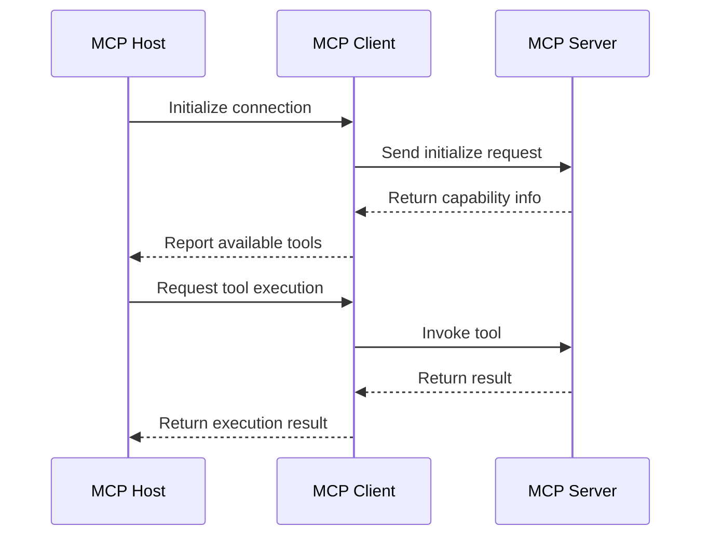

## Goal

This article aims to help developers understand MCP (Model Context Protocol) core concepts, architecture design, and implementation methods, and master how to let AI assistants connect to external tools and data sources.

## Background

AI assistants (like Claude, GPT) are powerful but cannot directly access external systems. MCP is an open protocol from Anthropic designed to solve this problem -- enabling AI to securely connect to various tools and data sources.

### Why Do We Need MCP?

1. **Tool Integration**: AI needs to access file systems, databases, APIs, etc.
2. **Data Access**: AI needs to obtain context information
3. **Security Control**: Needs standardized permission management
4. **Interoperability**: Different AI tools need unified interfaces

### MCP's Goal

MCP aims to create a universal protocol enabling AI to:
- Discover available tools
- Understand tool capabilities
- Securely invoke tools
- Obtain execution results

## 1. MCP Architecture

### Core Components

```
+-----------------------------------------------------------+
|                    MCP Architecture                         |
+-----------------------------------------------------------+
|                                                             |
|  +----------------+      +----------------+                |
|  |   MCP Host     |      |   MCP Server   |                |
|  |   (AI App)     |<---->|   (Tool Provider)               |
|  +----------------+      +----------------+                |
|         |                     |                             |
|         |                     |                             |
|         v                     v                             |
|  +----------------+      +----------------+                |
|  |   MCP Client   |      |  Tools/Resources|                |
|  |   (Protocol)   |      |  (Functionality)|                |
|  +----------------+      +----------------+                |
|                                                             |
+-----------------------------------------------------------+
```

### Communication Flow



## 2. MCP Protocol Details

### Message Format

MCP uses JSON-RPC 2.0 as the message format:

```typescript
// Request message
{
  "jsonrpc": "2.0",
  "id": 1,
  "method": "tools/call",
  "params": {
    "name": "read_file",
    "arguments": {
      "path": "/path/to/file.txt"
    }
  }
}

// Response message
{
  "jsonrpc": "2.0",
  "id": 1,
  "result": {
    "content": [
      {
        "type": "text",
        "text": "File content..."
      }
    ]
  }
}
```

### Capability Negotiation

```typescript
// Initialize request
{
  "jsonrpc": "2.0",
  "id": 1,
  "method": "initialize",
  "params": {
    "protocolVersion": "2024-11-05",
    "capabilities": {
      "tools": {},
      "resources": {}
    },
    "clientInfo": {
      "name": "my-ai-app",
      "version": "1.0.0"
    }
  }
}

// Initialize response
{
  "jsonrpc": "2.0",
  "id": 1,
  "result": {
    "protocolVersion": "2024-11-05",
    "capabilities": {
      "tools": {
        "listChanged": true
      },
      "resources": {
        "subscribe": true
      }
    },
    "serverInfo": {
      "name": "my-mcp-server",
      "version": "1.0.0"
    }
  }
}
```

## 3. MCP Server Implementation

### Node.js Implementation

```typescript
// server.ts
import { Server } from '@modelcontextprotocol/sdk/server/index.js';
import { StdioServerTransport } from '@modelcontextprotocol/sdk/server/stdio.js';

const server = new Server(
  {
    name: 'my-mcp-server',
    version: '1.0.0',
  },
  {
    capabilities: {
      tools: {},
      resources: {},
    },
  }
);

// Define tools
server.setRequestHandler('tools/list', async () => {
  return {
    tools: [
      {
        name: 'read_file',
        description: 'Read file content',
        inputSchema: {
          type: 'object',
          properties: {
            path: {
              type: 'string',
              description: 'File path',
            },
          },
          required: ['path'],
        },
      },
      {
        name: 'write_file',
        description: 'Write file content',
        inputSchema: {
          type: 'object',
          properties: {
            path: {
              type: 'string',
              description: 'File path',
            },
            content: {
              type: 'string',
              description: 'File content',
            },
          },
          required: ['path', 'content'],
        },
      },
    ],
  };
});

// Handle tool calls
server.setRequestHandler('tools/call', async (request) => {
  const { name, arguments: args } = request.params;

  switch (name) {
    case 'read_file':
      const content = await readFile(args.path);
      return {
        content: [
          {
            type: 'text',
            text: content,
          },
        ],
      };

    case 'write_file':
      await writeFile(args.path, args.content);
      return {
        content: [
          {
            type: 'text',
            text: 'File written successfully',
          },
        ],
      };

    default:
      throw new Error(`Unknown tool: ${name}`);
  }
});

// Start server
async function main() {
  const transport = new StdioServerTransport();
  await server.connect(transport);
  console.error('MCP Server running on stdio');
}

main().catch(console.error);
```

### Python Implementation

```python
# server.py
from mcp.server import Server
from mcp.server.stdio import stdio_server
from mcp.types import Tool, TextContent
import asyncio
import json

server = Server("my-mcp-server")

@server.list_tools()
async def list_tools():
    return [
        Tool(
            name="read_file",
            description="Read file content",
            inputSchema={
                "type": "object",
                "properties": {
                    "path": {
                        "type": "string",
                        "description": "File path"
                    }
                },
                "required": ["path"]
            }
        ),
        Tool(
            name="write_file",
            description="Write file content",
            inputSchema={
                "type": "object",
                "properties": {
                    "path": {
                        "type": "string",
                        "description": "File path"
                    },
                    "content": {
                        "type": "string",
                        "description": "File content"
                    }
                },
                "required": ["path", "content"]
            }
        )
    ]

@server.call_tool()
async def call_tool(name: str, arguments: dict):
    if name == "read_file":
        with open(arguments["path"], "r") as f:
            content = f.read()
        return [TextContent(type="text", text=content)]
    
    elif name == "write_file":
        with open(arguments["path"], "w") as f:
            f.write(arguments["content"])
        return [TextContent(type="text", text="File written successfully")]
    
    else:
        raise ValueError(f"Unknown tool: {name}")

async def main():
    async with stdio_server() as (read_stream, write_stream):
        await server.run(
            read_stream,
            write_stream,
            server.create_initialization_options()
        )

if __name__ == "__main__":
    asyncio.run(main())
```

## 4. MCP Client Implementation

### Connecting to MCP Server

```typescript
// client.ts
import { Client } from '@modelcontextprotocol/sdk/client/index.js';
import { StdioClientTransport } from '@modelcontextprotocol/sdk/client/stdio.js';

async function main() {
  // Create transport layer
  const transport = new StdioClientTransport({
    command: 'node',
    args: ['server.js'],
  });

  // Create client
  const client = new Client(
    {
      name: 'my-mcp-client',
      version: '1.0.0',
    },
    {
      capabilities: {},
    }
  );

  // Connect to server
  await client.connect(transport);

  // List available tools
  const tools = await client.request(
    { method: 'tools/list' },
    {}
  );
  console.log('Available tools:', tools);

  // Invoke tool
  const result = await client.request(
    {
      method: 'tools/call',
      params: {
        name: 'read_file',
        arguments: {
          path: '/path/to/file.txt',
        },
      },
    },
    {}
  );
  console.log('Result:', result);
}

main().catch(console.error);
```

## 5. Practical Application Examples

### 1. File System Access

```typescript
// MCP Server for file system
const fileSystemServer = {
  tools: [
    {
      name: 'list_directory',
      description: 'List directory contents',
      inputSchema: {
        type: 'object',
        properties: {
          path: { type: 'string' },
        },
      },
    },
    {
      name: 'read_file',
      description: 'Read file',
      inputSchema: {
        type: 'object',
        properties: {
          path: { type: 'string' },
        },
      },
    },
  ],
};
```

### 2. Database Query

```typescript
// MCP Server for database
const databaseServer = {
  tools: [
    {
      name: 'query',
      description: 'Execute SQL query',
      inputSchema: {
        type: 'object',
        properties: {
          sql: { type: 'string' },
        },
      },
    },
    {
      name: 'list_tables',
      description: 'List all tables',
      inputSchema: {
        type: 'object',
        properties: {},
      },
    },
  ],
};
```

### 3. API Call

```typescript
// MCP Server for API
const apiServer = {
  tools: [
    {
      name: 'get_request',
      description: 'Send GET request',
      inputSchema: {
        type: 'object',
        properties: {
          url: { type: 'string' },
          headers: { type: 'object' },
        },
      },
    },
    {
      name: 'post_request',
      description: 'Send POST request',
      inputSchema: {
        type: 'object',
        properties: {
          url: { type: 'string' },
          body: { type: 'object' },
        },
      },
    },
  ],
};
```

## 6. Security Considerations

### Permission Control

```typescript
// Permission check middleware
async function checkPermission(toolName: string, args: any) {
  // Check if tool is allowed
  const allowedTools = ['read_file', 'list_directory'];
  if (!allowedTools.includes(toolName)) {
    throw new Error('Tool not allowed');
  }

  // Check path permissions
  if (toolName === 'read_file') {
    const allowedPaths = ['/allowed/path'];
    if (!allowedPaths.some(p => args.path.startsWith(p))) {
      throw new Error('Path not allowed');
    }
  }

  return true;
}
```

### Audit Logging

```typescript
// Audit logging
function logToolCall(toolName: string, args: any, result: any) {
  console.log(JSON.stringify({
    timestamp: new Date().toISOString(),
    tool: toolName,
    args,
    result,
    user: getCurrentUser(),
  }));
}
```

## 7. MCP Ecosystem

### Existing MCP Servers

```markdown
## Official MCP Servers

### File System
- @modelcontextprotocol/server-filesystem

### Database
- @modelcontextprotocol/server-postgres
- @modelcontextprotocol/server-sqlite

### API
- @modelcontextprotocol/server-github
- @modelcontextprotocol/server-slack

### Development Tools
- @modelcontextprotocol/server-git
- @modelcontextprotocol/server-puppeteer
```

### Tool Integration

```markdown
## Applications Supporting MCP

### Claude Desktop
- Native MCP support
- Can configure custom servers

### Claude Code
- Supports MCP servers
- Can access file systems, Git, etc.

### Other AI Applications
- Integrate MCP through SDK
- Can create custom servers
```

## 8. Best Practices

### 1. Tool Design

```typescript
// Good tool design
{
  name: "search_files",
  description: "Search for files containing specific content in a directory",
  inputSchema: {
    type: "object",
    properties: {
      directory: {
        type: "string",
        description: "Search directory"
      },
      pattern: {
        type: "string",
        description: "Search pattern (regex)"
      },
      fileTypes: {
        type: "array",
        items: { type: "string" },
        description: "File type filter"
      }
    },
    required: ["directory", "pattern"]
  }
}
```

### 2. Error Handling

```typescript
// Error handling
try {
  const result = await executeTool(toolName, args);
  return { success: true, data: result };
} catch (error) {
  return {
    success: false,
    error: {
      message: error.message,
      code: error.code,
    },
  };
}
```

### 3. Performance Optimization

```typescript
// Performance optimization
// 1. Cache tool list
let cachedTools = null;
async function getTools() {
  if (!cachedTools) {
    cachedTools = await fetchTools();
  }
  return cachedTools;
}

// 2. Batch operations
async function executeBatch(toolCalls) {
  return Promise.all(toolCalls.map(executeTool));
}
```

## Summary

MCP is an important open protocol that provides a standardized way for AI to interact with the outside world.

| Feature | Advantage | Use Case |
|---------|-----------|----------|
| Standardization | Unified interface | Multi-tool integration |
| Security | Permission control | Enterprise applications |
| Extensibility | Pluggable architecture | Various tools |
| Interoperability | Cross-platform support | Multiple AI applications |

**Recommendations**:

1. **Understand MCP**: This is an important standard in the AI toolchain
2. **Try Implementation**: Start with simple servers
3. **Watch Ecosystem**: MCP ecosystem is rapidly developing
4. **Security First**: Pay attention to permission control in implementation
5. **Continuous Learning**: MCP is still evolving

MCP extends AI's capabilities to the external world, providing a foundation for building smarter applications. This introductory guide will help you understand MCP's value and implementation methods.
