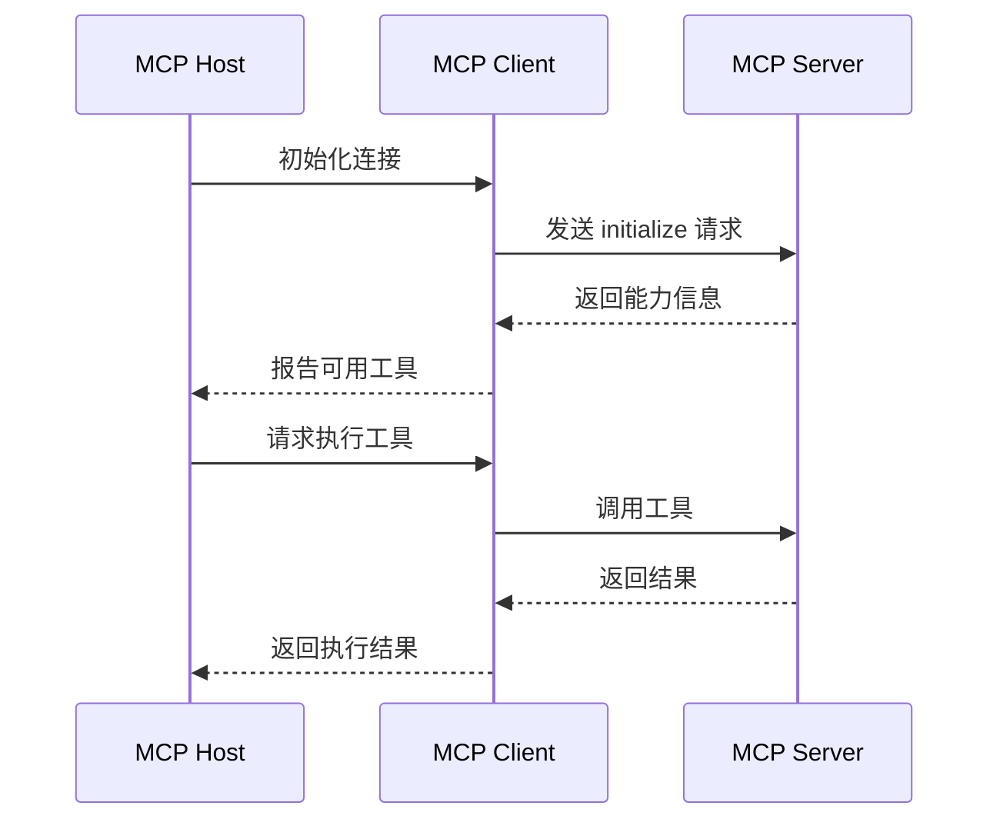

## 目标

本文旨在帮助开发者理解 MCP（Model Context Protocol）的核心概念、架构设计和实现方式，掌握如何让 AI 助手连接外部工具和数据源。

## 背景

AI 助手（如 Claude、GPT）虽然强大，但它们无法直接访问外部系统。MCP 是 Anthropic 推出的开放协议，旨在解决这个问题——让 AI 能够安全地连接到各种工具和数据源。

### 为什么需要 MCP？

1. **工具集成**：AI 需要访问文件系统、数据库、API 等
2. **数据访问**：AI 需要获取上下文信息
3. **安全控制**：需要标准化的权限管理
4. **互操作性**：不同 AI 工具需要统一的接口

### MCP 的目标

MCP 的目标是创建一个通用的协议，让 AI 能够：
- 发现可用的工具
- 理解工具的能力
- 安全地调用工具
- 获取执行结果

## 一、MCP 架构

### 核心组件

```
┌─────────────────────────────────────────────────────────┐
│                    MCP 架构                              │
├─────────────────────────────────────────────────────────┤
│                                                         │
│  ┌─────────────┐      ┌─────────────┐                  │
│  │  MCP Host   │      │  MCP Server │                  │
│  │  (AI 应用)  │◄────►│  (工具提供) │                  │
│  └─────────────┘      └─────────────┘                  │
│         │                    │                          │
│         │                    │                          │
│         ▼                    ▼                          │
│  ┌─────────────┐      ┌─────────────┐                  │
│  │  MCP Client │      │   工具/资源  │                  │
│  │  (协议实现) │      │  (实际功能) │                  │
│  └─────────────┘      └─────────────┘                  │
│                                                         │
└─────────────────────────────────────────────────────────┘
```

### 通信流程



## 二、MCP 协议详解

### 消息格式

MCP 使用 JSON-RPC 2.0 作为消息格式：

```typescript
// 请求消息
{
  "jsonrpc": "2.0",
  "id": 1,
  "method": "tools/call",
  "params": {
    "name": "read_file",
    "arguments": {
      "path": "/path/to/file.txt"
    }
  }
}

// 响应消息
{
  "jsonrpc": "2.0",
  "id": 1,
  "result": {
    "content": [
      {
        "type": "text",
        "text": "文件内容..."
      }
    ]
  }
}
```

### 能力协商

```typescript
// 初始化请求
{
  "jsonrpc": "2.0",
  "id": 1,
  "method": "initialize",
  "params": {
    "protocolVersion": "2024-11-05",
    "capabilities": {
      "tools": {},
      "resources": {}
    },
    "clientInfo": {
      "name": "my-ai-app",
      "version": "1.0.0"
    }
  }
}

// 初始化响应
{
  "jsonrpc": "2.0",
  "id": 1,
  "result": {
    "protocolVersion": "2024-11-05",
    "capabilities": {
      "tools": {
        "listChanged": true
      },
      "resources": {
        "subscribe": true
      }
    },
    "serverInfo": {
      "name": "my-mcp-server",
      "version": "1.0.0"
    }
  }
}
```

## 三、MCP Server 实现

### Node.js 实现

```typescript
// server.ts
import { Server } from '@modelcontextprotocol/sdk/server/index.js';
import { StdioServerTransport } from '@modelcontextprotocol/sdk/server/stdio.js';

const server = new Server(
  {
    name: 'my-mcp-server',
    version: '1.0.0',
  },
  {
    capabilities: {
      tools: {},
      resources: {},
    },
  }
);

// 定义工具
server.setRequestHandler('tools/list', async () => {
  return {
    tools: [
      {
        name: 'read_file',
        description: '读取文件内容',
        inputSchema: {
          type: 'object',
          properties: {
            path: {
              type: 'string',
              description: '文件路径',
            },
          },
          required: ['path'],
        },
      },
      {
        name: 'write_file',
        description: '写入文件内容',
        inputSchema: {
          type: 'object',
          properties: {
            path: {
              type: 'string',
              description: '文件路径',
            },
            content: {
              type: 'string',
              description: '文件内容',
            },
          },
          required: ['path', 'content'],
        },
      },
    ],
  };
});

// 处理工具调用
server.setRequestHandler('tools/call', async (request) => {
  const { name, arguments: args } = request.params;

  switch (name) {
    case 'read_file':
      const content = await readFile(args.path);
      return {
        content: [
          {
            type: 'text',
            text: content,
          },
        ],
      };

    case 'write_file':
      await writeFile(args.path, args.content);
      return {
        content: [
          {
            type: 'text',
            text: '文件写入成功',
          },
        ],
      };

    default:
      throw new Error(`Unknown tool: ${name}`);
  }
});

// 启动服务器
async function main() {
  const transport = new StdioServerTransport();
  await server.connect(transport);
  console.error('MCP Server running on stdio');
}

main().catch(console.error);
```

### Python 实现

```python
# server.py
from mcp.server import Server
from mcp.server.stdio import stdio_server
from mcp.types import Tool, TextContent
import asyncio
import json

server = Server("my-mcp-server")

@server.list_tools()
async def list_tools():
    return [
        Tool(
            name="read_file",
            description="读取文件内容",
            inputSchema={
                "type": "object",
                "properties": {
                    "path": {
                        "type": "string",
                        "description": "文件路径"
                    }
                },
                "required": ["path"]
            }
        ),
        Tool(
            name="write_file",
            description="写入文件内容",
            inputSchema={
                "type": "object",
                "properties": {
                    "path": {
                        "type": "string",
                        "description": "文件路径"
                    },
                    "content": {
                        "type": "string",
                        "description": "文件内容"
                    }
                },
                "required": ["path", "content"]
            }
        )
    ]

@server.call_tool()
async def call_tool(name: str, arguments: dict):
    if name == "read_file":
        with open(arguments["path"], "r") as f:
            content = f.read()
        return [TextContent(type="text", text=content)]
    
    elif name == "write_file":
        with open(arguments["path"], "w") as f:
            f.write(arguments["content"])
        return [TextContent(type="text", text="文件写入成功")]
    
    else:
        raise ValueError(f"Unknown tool: {name}")

async def main():
    async with stdio_server() as (read_stream, write_stream):
        await server.run(
            read_stream,
            write_stream,
            server.create_initialization_options()
        )

if __name__ == "__main__":
    asyncio.run(main())
```

## 四、MCP Client 实现

### 连接 MCP Server

```typescript
// client.ts
import { Client } from '@modelcontextprotocol/sdk/client/index.js';
import { StdioClientTransport } from '@modelcontextprotocol/sdk/client/stdio.js';

async function main() {
  // 创建传输层
  const transport = new StdioClientTransport({
    command: 'node',
    args: ['server.js'],
  });

  // 创建客户端
  const client = new Client(
    {
      name: 'my-mcp-client',
      version: '1.0.0',
    },
    {
      capabilities: {},
    }
  );

  // 连接服务器
  await client.connect(transport);

  // 列出可用工具
  const tools = await client.request(
    { method: 'tools/list' },
    {}
  );
  console.log('Available tools:', tools);

  // 调用工具
  const result = await client.request(
    {
      method: 'tools/call',
      params: {
        name: 'read_file',
        arguments: {
          path: '/path/to/file.txt',
        },
      },
    },
    {}
  );
  console.log('Result:', result);
}

main().catch(console.error);
```

## 五、实际应用案例

### 1. 文件系统访问

```typescript
// MCP Server for file system
const fileSystemServer = {
  tools: [
    {
      name: 'list_directory',
      description: '列出目录内容',
      inputSchema: {
        type: 'object',
        properties: {
          path: { type: 'string' },
        },
      },
    },
    {
      name: 'read_file',
      description: '读取文件',
      inputSchema: {
        type: 'object',
        properties: {
          path: { type: 'string' },
        },
      },
    },
  ],
};
```

### 2. 数据库查询

```typescript
// MCP Server for database
const databaseServer = {
  tools: [
    {
      name: 'query',
      description: '执行 SQL 查询',
      inputSchema: {
        type: 'object',
        properties: {
          sql: { type: 'string' },
        },
      },
    },
    {
      name: 'list_tables',
      description: '列出所有表',
      inputSchema: {
        type: 'object',
        properties: {},
      },
    },
  ],
};
```

### 3. API 调用

```typescript
// MCP Server for API
const apiServer = {
  tools: [
    {
      name: 'get_request',
      description: '发送 GET 请求',
      inputSchema: {
        type: 'object',
        properties: {
          url: { type: 'string' },
          headers: { type: 'object' },
        },
      },
    },
    {
      name: 'post_request',
      description: '发送 POST 请求',
      inputSchema: {
        type: 'object',
        properties: {
          url: { type: 'string' },
          body: { type: 'object' },
        },
      },
    },
  ],
};
```

## 六、安全考虑

### 权限控制

```typescript
// 权限检查中间件
async function checkPermission(toolName: string, args: any) {
  // 检查工具是否被允许
  const allowedTools = ['read_file', 'list_directory'];
  if (!allowedTools.includes(toolName)) {
    throw new Error('Tool not allowed');
  }

  // 检查路径权限
  if (toolName === 'read_file') {
    const allowedPaths = ['/allowed/path'];
    if (!allowedPaths.some(p => args.path.startsWith(p))) {
      throw new Error('Path not allowed');
    }
  }

  return true;
}
```

### 审计日志

```typescript
// 审计日志
function logToolCall(toolName: string, args: any, result: any) {
  console.log(JSON.stringify({
    timestamp: new Date().toISOString(),
    tool: toolName,
    args,
    result,
    user: getCurrentUser(),
  }));
}
```

## 七、MCP 生态

### 现有的 MCP Server

```markdown
## 官方 MCP Server

### 文件系统
- @modelcontextprotocol/server-filesystem

### 数据库
- @modelcontextprotocol/server-postgres
- @modelcontextprotocol/server-sqlite

### API
- @modelcontextprotocol/server-github
- @modelcontextprotocol/server-slack

### 开发工具
- @modelcontextprotocol/server-git
- @modelcontextprotocol/server-puppeteer
```

### 工具集成

```markdown
## 支持 MCP 的应用

### Claude Desktop
- 原生支持 MCP
- 可以配置自定义 Server

### Claude Code
- 支持 MCP Server
- 可以访问文件系统、Git 等

### 其他 AI 应用
- 通过 SDK 集成 MCP
- 可以自定义 Server
```

## 八、最佳实践

### 1. 工具设计

```typescript
// 好的工具设计
{
  name: "search_files",
  description: "在指定目录中搜索包含特定内容的文件",
  inputSchema: {
    type: "object",
    properties: {
      directory: {
        type: "string",
        description: "搜索目录"
      },
      pattern: {
        type: "string",
        description: "搜索模式（正则表达式）"
      },
      fileTypes: {
        type: "array",
        items: { type: "string" },
        description: "文件类型过滤"
      }
    },
    required: ["directory", "pattern"]
  }
}
```

### 2. 错误处理

```typescript
// 错误处理
try {
  const result = await executeTool(toolName, args);
  return { success: true, data: result };
} catch (error) {
  return {
    success: false,
    error: {
      message: error.message,
      code: error.code,
    },
  };
}
```

### 3. 性能优化

```typescript
// 性能优化
// 1. 缓存工具列表
let cachedTools = null;
async function getTools() {
  if (!cachedTools) {
    cachedTools = await fetchTools();
  }
  return cachedTools;
}

// 2. 批量操作
async function executeBatch(toolCalls) {
  return Promise.all(toolCalls.map(executeTool));
}
```

## 总结

MCP 是一个重要的开放协议，它为 AI 与外部世界的交互提供了标准化的方式。

| 特性 | 优势 | 适用场景 |
|------|------|----------|
| 标准化 | 统一的接口 | 多工具集成 |
| 安全性 | 权限控制 | 企业应用 |
| 扩展性 | 可插拔架构 | 各种工具 |
| 互操作性 | 跨平台支持 | 多 AI 应用 |

**姐姐的建议**：

1. **了解 MCP**：这是 AI 工具链的重要标准
2. **尝试实现**：从简单的 Server 开始
3. **关注生态**：MCP 生态正在快速发展
4. **安全优先**：在实现时注意权限控制
5. **持续学习**：MCP 还在演进中

MCP 将 AI 的能力扩展到了外部世界，为构建更智能的应用提供了基础。希望这篇入门指南能帮助宝宝们理解 MCP 的价值和实现方式。
